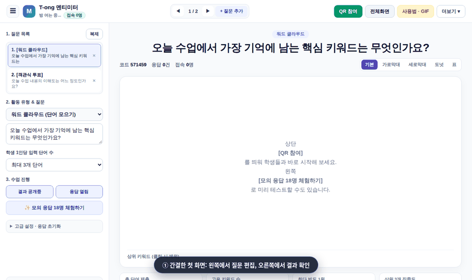
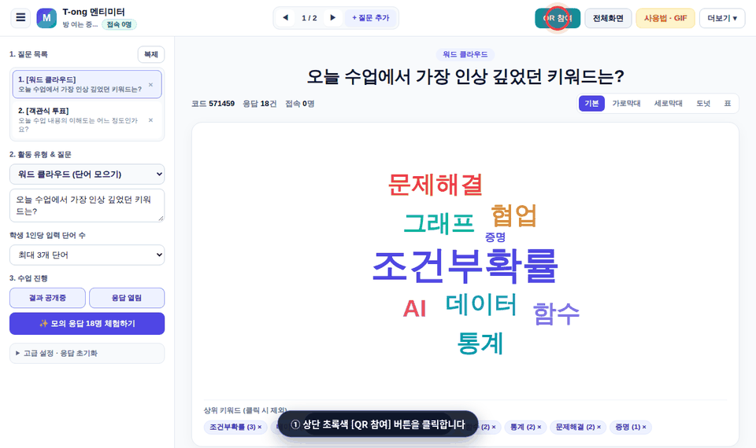
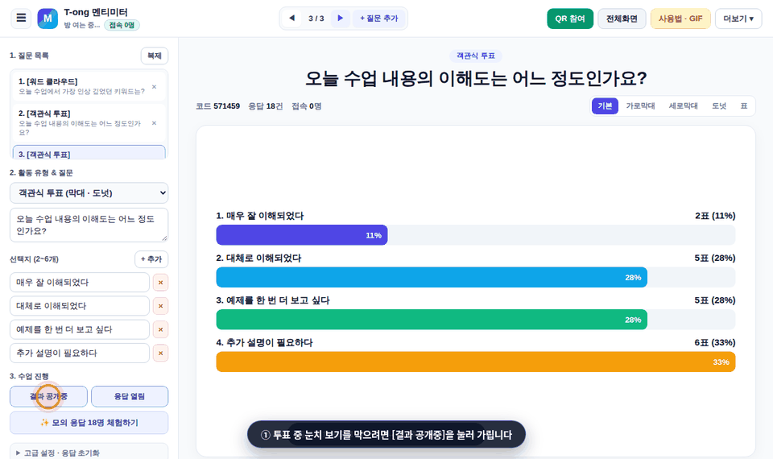
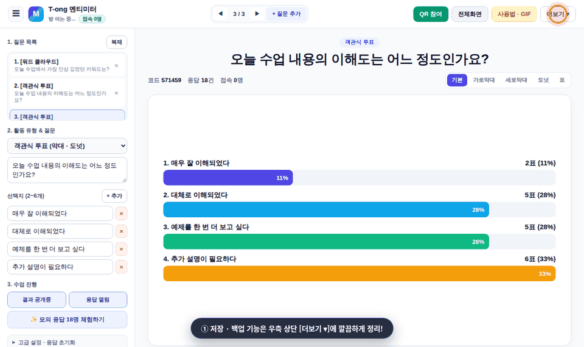
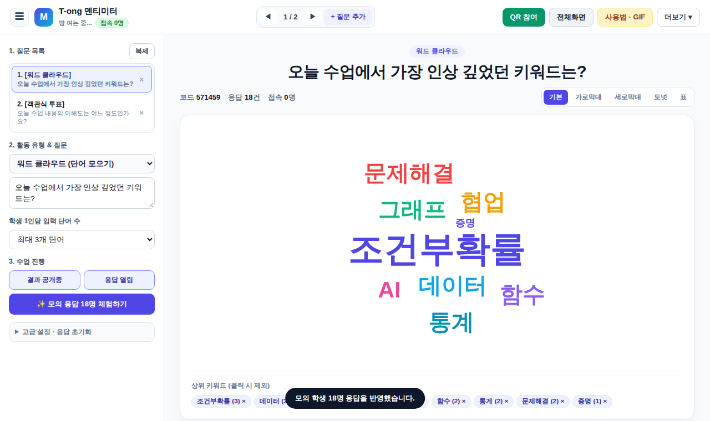
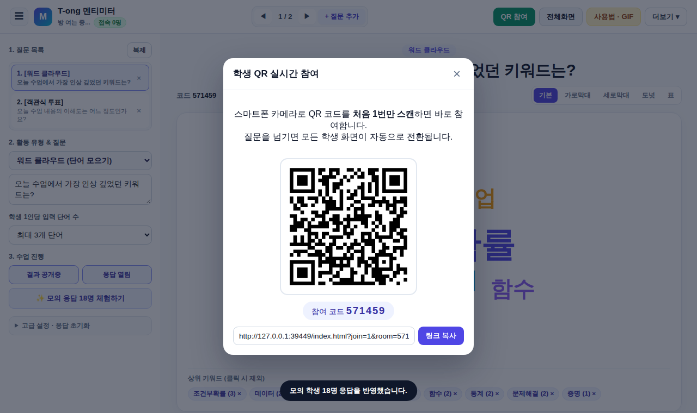
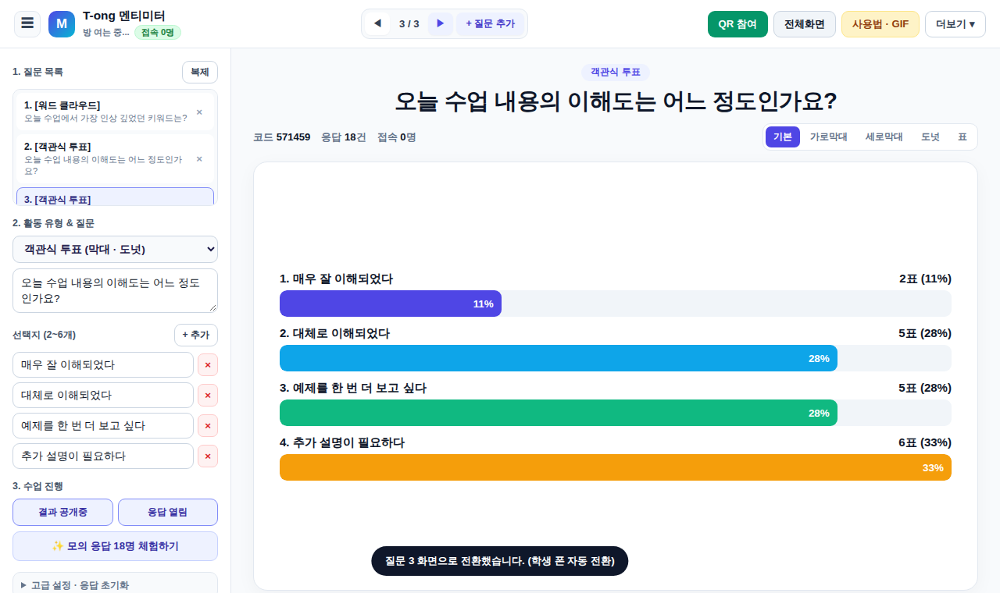
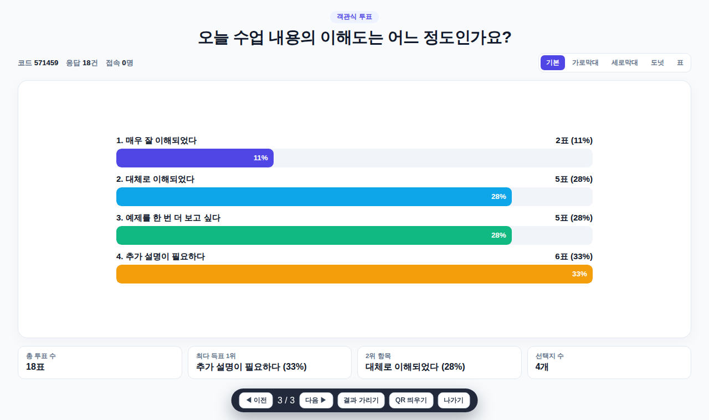
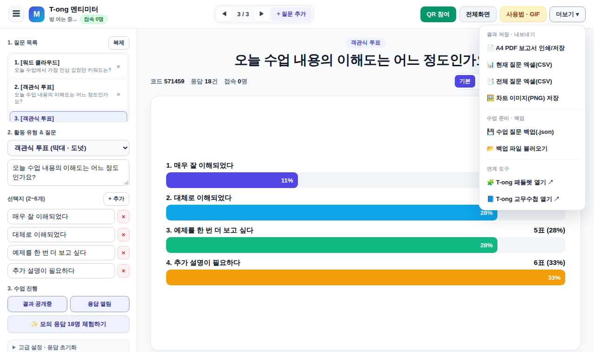

# T-ong 멘티미터 사용 설명서 (GIF · 스크린샷 · 동영상 시연 대본)

누구나 별도 회원가입이나 앱 설치 없이 **30초 만에 실시간 소통 수업**을 시작할 수 있도록 화면을 최대한 간결하고 단순하게 구성했습니다.

---

## 1. 빠르게 보는 움직이는 GIF 가이드 (핵심 4단계)

### GIF 1. 30초 만에 시작하기 (질문 입력 → 모의 응답 체험)
왼쪽에서 질문을 적고 **[✨ 모의 응답 18명 체험하기]**를 누르면 실시간 워드클라우드와 핵심 요약 지표가 바로 나타납니다.

### GIF 2. QR 참여코드 띄우기 & 질문 추가·전환
상단 **[QR 참여]**를 눌러 학생들에게 코드를 보여준 뒤, **[+ 질문 추가]**와 **[◀ / ▶]** 버튼으로 질문을 넘기면 **모든 학생 스마트폰 화면이 자동으로 전환**됩니다.

### GIF 3. 결과 가리기 · 차트 전환 · 전체화면 송출
투표 중 다른 친구의 응답에 휩쓸리지 않도록 **[결과 가리기]**를 쓰고, 공개 후 **[가로막대 · 세로막대 · 도넛 · 표]**로 즉시 바꿀 수 있습니다. 교실 TV/프로젝터에는 **[전체화면]**으로 깔끔하게 송출하세요.

### GIF 4. [더보기 ▾] 메뉴에서 PDF · 엑셀(CSV) · 수업 백업 저장
평소 화면을 복잡하지 않게 유지하기 위해 저장·백업 기능은 우측 상단 **[더보기 ▾]** 메뉴에 깔끔하게 모아 두었습니다.

---

## 2. 스크린샷으로 보는 단계별 사용 설명서

### STEP 1. 간결해진 기본 화면 (왼쪽 3단계 편집 + 오른쪽 실시간 결과)
- **상단 바**: 질문 이동(`◀ / ▶`, `+ 질문 추가`)과 핵심 버튼(`QR 참여`, `전체화면`, `사용법 · GIF`, `더보기 ▾`)만 남겼습니다.
- **왼쪽 패널**: `1. 질문 목록` → `2. 활동 유형 & 질문` → `3. 수업 진행` 3단계만 순서대로 따라 하면 됩니다.

### STEP 2. 학생 QR 참여 화면
- 상단 초록색 **[QR 참여]** 버튼을 누르면 큰 QR 코드와 6자리 참여 코드가 표시됩니다.
- 학생들은 스마트폰 카메라로 **처음 1번만 스캔**하면 바로 입장합니다.

### STEP 3. 객관식 투표 & 차트 모양 즉시 전환
- 상단 차트 탭에서 **기본 / 가로막대 / 세로막대 / 도넛 / 표**로 클릭 한 번에 바꿀 수 있습니다.

### STEP 4. 전체화면 송출 모드 (교실 TV · 프로젝터용)
- 상단 **[전체화면]**을 누르면 왼쪽 편집 패널이 사라지고 질문과 그래프만 꽉 차게 보입니다.
- 하단 플로팅 바에서 **이전 / 다음 / 결과 가리기 / QR 띄우기 / 나가기**를 바로 조작할 수 있습니다.

### STEP 5. 결과 저장 & 수업 백업 ([더보기 ▾] 메뉴)
- **수업 전 준비**: 집이나 교무실에서 질문을 만들고 **수업 질문 백업(.json)**으로 저장 → 교실 PC에서 **백업 파일 불러오기**
- **수업 후 기록**: **A4 PDF 보고서**, **현재/전체 엑셀(CSV)**, **차트 PNG 저장** 지원 (CSV는 구글 스프레드시트에서 바로 열 수 있습니다.)

---

## 3. 동영상 사용 설명서 시연 대본 (총 약 2분 20초)

아래 대본 순서대로 화면을 직접 조작하며 녹화하면 친절한 동영상 매뉴얼을 바로 제작할 수 있습니다.

| 장면 | 시간 | 화면 조작 가이드 | 내레이션 대본 |
| :--- | :---: | :--- | :--- |
| **장면 1** 오프닝 & 첫 화면 | `0:00 ~ 0:25` | T-ong 멘티미터 첫 화면 열기 → 마우스로 상단 바(질문 이동, QR 참여, 전체화면, 더보기)와 왼쪽 3단계 패널을 가볍게 가리킴 | “안녕하세요! 별도 회원가입이나 앱 설치 없이 30초 만에 시작하는 실시간 소통 도구, T-ong 멘티미터 사용법을 안내해 드리겠습니다. 화면은 아주 단순합니다. 왼쪽에서 질문을 만들고, 오른쪽에서 학생들의 실시간 응답을 바로 확인할 수 있습니다.” |
| **장면 2** 질문 작성 & 체험 | `0:25 ~ 0:55` | 왼쪽 질문 입력창에 질문 수정 → **[✨ 모의 응답 18명 체험하기]** 클릭 → 워드클라우드와 하단 요약 지표 보여주기 | “먼저 왼쪽에서 활동 유형을 고르고 질문을 입력합니다. 워드클라우드부터 객관식 투표, 척도, 순위, 퀴즈까지 8가지를 지원합니다. 수업 전에 어떻게 보일지 궁금하다면 ‘모의 응답 18명 체험하기’를 눌러 보세요. 이렇게 학생들이 보낸 단어가 크고 선명한 그래프로 즉시 정리됩니다.” |
| **장면 3** QR 참여 & 질문 전환 | `0:55 ~ 1:25` | 상단 초록색 **[QR 참여]** 클릭 → 큰 QR 코드 확인 후 닫기 → **[+ 질문 추가]** 클릭 → 유형을 ‘객관식 투표’로 변경 → **[◀ / ▶]** 버튼으로 슬라이드 이동 | “이제 실제 수업을 시작해 볼까요? 상단의 ‘QR 참여’ 버튼을 누르면 큰 QR 코드가 나타납니다. 학생들은 스마트폰 카메라로 딱 한 번만 스캔하면 됩니다. 질문을 여러 개 준비하고 싶다면 상단 ‘+ 질문 추가’를 누르세요. 선생님이 이전·다음 버튼으로 질문을 넘기면, 학생들 스마트폰 화면도 자동으로 함께 넘어갑니다.” |
| **장면 4** 수업 진행 꿀팁 | `1:25 ~ 1:55` | 왼쪽 **[결과 공개중]** 클릭해 가리기 → **[결과 공개하기]** 클릭 → 차트 탭 **[도넛 → 세로막대 → 표]** 클릭 → 상단 **[전체화면]** 클릭 후 하단 제어 바 보여주기 → **[나가기]** | “투표 중에 친구들 눈치를 보지 않게 하려면 ‘결과 가리기’를 켜 두었다가, 응답이 모이면 한 번에 공개해 보세요. 결과는 클릭 한 번으로 막대그래프, 도넛 차트, 데이터 표로 바꿀 수 있습니다. 교실 TV나 프로젝터에 띄울 때는 상단 ‘전체화면’을 누르면 편집 메뉴가 사라지고 질문과 그래프만 깔끔하게 보여집니다.” |
| **장면 5** 저장·백업 & 마무리 | `1:55 ~ 2:20` | 우측 상단 **[더보기 ▾]** 클릭 → PDF 보고서, 엑셀(CSV), 수업 질문 백업(.json) 항목을 차례로 가리킨 뒤 닫기 | “마지막으로 수업 기록 저장이나 사전 준비 파일 백업은 우측 상단 ‘더보기’ 메뉴에 모두 모여 있습니다. 수업이 끝난 뒤 A4 PDF 보고서나 엑셀 파일로 한 번에 내려받아 구글 시트에도 바로 올릴 수 있습니다. 이제 T-ong 멘티미터로 더 쉽고 활기찬 수업을 시작해 보세요!” |

---

## 4. 자주 묻는 질문 (FAQ)

- **Q. 여러 선생님이 동시에 써도 데이터가 섞이지 않나요?**
  - A. 네! 접속할 때마다 선생님마다 고유한 **6자리 참여 코드**가 자동 발급되므로 다른 학교·다른 반 데이터와 절대 섞이지 않습니다.
- **Q. 한 반에 몇 명까지 동시에 참여할 수 있나요?**
  - A. 1개 방 기준 **1~40명(일반 학급)** 매우 쾌적, **최대 60명(합반)**까지 원활하게 동작합니다.
- **Q. 학생이 여러 번 중복 투표하는 것을 막을 수 있나요?**
  - A. 왼쪽 하단 **고급 설정**의 **[1인 1회 제한: ON]**이 기본으로 켜져 있어 자동으로 중복 제출을 막아줍니다.
